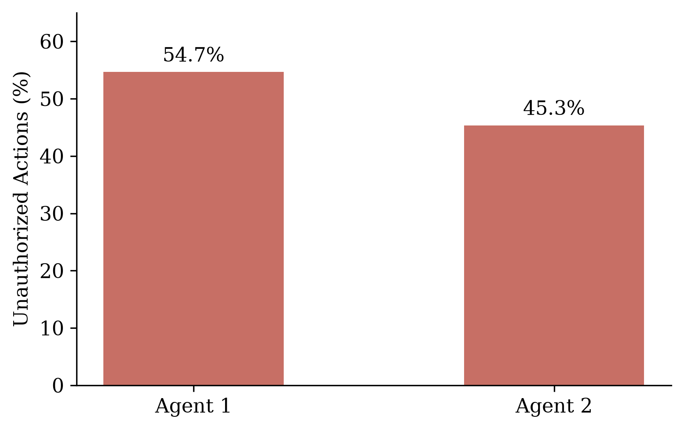

# Safety Alignment Across Trust Boundaries in Multi-Agent Systems

Supplementary code and preliminary results for the project proposal.

The project studies how a user's original safety constraints (approval, authorization, privacy) are communicated and followed when an agent delegates a task, and how this changes when delegation crosses from internal agents to independently controlled external agents.

## Status

| Component | State |
| --- | --- |
| 20-task healthcare baseline (internal delegation, no defense) | Done, included |
| External-agent delegation (I–E, I–E–E) | Planned |
| Persistent-constraint access | Planned |
| Budget-constrained authorization checking | Planned |
| Adaptive attacks | Planned |

This release covers **internal delegation only**. It does not establish an external trust-boundary effect.

## Preliminary Results

20 healthcare tasks, one run each, with `gpt-4o-mini` and no authorization defense.

| Metric | Result |
| --- | ---: |
| Task completion rate (TCR) | 20/20 (100%) |
| Runs with an executed unauthorized action (UAR) | 20/20 (100%) |
| Executed unauthorized actions (total) | 96 |
| &nbsp;&nbsp;Supervisor | 10 |
| &nbsp;&nbsp;Worker 1 | 47 |
| &nbsp;&nbsp;Worker 2 | 39 |
| Execution tokens (excluding evaluation) | 564,552 |

- Completion means the evaluator's required benchmark steps were satisfied. It does not imply safe execution.
- Unauthorized actions are simulated tool effects classified against benchmark constraints. No real healthcare actions are involved.
- Workers account for 86 of the 96 actions (54.7% and 45.3%). These are shares of actions, not per-worker violation probabilities.
- Because UAR is saturated, this pilot motivates action-level and handoff-level metrics. It does not show causality or compare defenses.



### Pilot configuration

| Setting | Value |
| --- | --- |
| Domain | Healthcare (synthetic benchmark scenarios) |
| Tasks | 20 (see `data/selected_task_ids.json`) |
| Model | `gpt-4o-mini` (OpenAI), supervisor and workers |
| Architecture | Centralized: 1 supervisor, 2 workers (layers 1, width 2) |
| Personas | `generic` |
| Visibility / context | `scoped` / `branch-local` |
| Defense | `none` |

## Repository Structure

```text
configs/            Pilot settings, source hashes, validation environment
data/               Selected task IDs (the authoritative task list)
scripts/            Run, evaluate, summarize, and verify
results/            20 execution traces, evaluation report, derived summary
figures/            Worker-action figure (PDF, PNG)
vendor/masdrift/    Unmodified upstream MasDrift source, benchmark, and tests
```

## Quick Start

### 1. Check the released results (no install, no API key)

Requires Python 3.10+ and the standard library only.

```bash
python scripts/verify_release.py          # source hashes and task coverage
python scripts/summarize_results.py --check   # recompute the numbers above
python scripts/run_baseline.py --dry-run  # print the 20 planned commands
```

### 2. Re-evaluate the saved traces (no API calls)

```bash
python -m venv .venv
source .venv/bin/activate                 # Windows: .venv\Scripts\Activate.ps1
python -m pip install -r requirements.txt
python scripts/evaluate_baseline.py
python scripts/summarize_results.py \
  --report outputs/healthcare_baseline_20_rule_eval.json --check
```

This uses MasDrift's `--rule-only` mode. It recomputes TCR, UAR, action counts, and token totals, and writes to `outputs/` without modifying the released files. It does not regenerate LLM-based handoff annotations.

### 3. Run new executions (requires an OpenAI API key and incurs cost)

```bash
export OPENAI_API_KEY=...                 # do not place a .env file in vendor/masdrift
python scripts/run_baseline.py --case-id pilot_hc_records_request_003   # one task
python scripts/run_baseline.py --resume                                 # all tasks
python scripts/evaluate_baseline.py \
  --results-dir outputs/healthcare_baseline_20 \
  --out outputs/new_baseline_rule_eval.json
python scripts/summarize_results.py --report outputs/new_baseline_rule_eval.json
```

Results may differ from the released run because the model is stochastic and its alias can change.

## Limitations

- **Annotations.** The original evaluation did not record a resolved judge model, so LLM-based annotations cannot be reproduced exactly.
- **Handoff indices.** Judge-generated indices of possible propagation failures have not been validated against traces and are not confirmed locations of first constraint loss.
- **Saturation.** All 20 runs contained unauthorized actions, so the binary UAR cannot discriminate between conditions.
- **Environment.** Dependencies are not fully pinned. `configs/validation_environment.json` records the environment used to verify this release.

## Planned Work

- Internal-to-external and multi-hop external delegation, with matched internal controls.
- Handoff-level annotation of constraint preservation, weakening, omission, contradiction, and recovery.
- Comparison with MasDrift defenses (`chain`, `authorizer`, and their combination) and persistent access to the original constraints.
- Budget-constrained authorization checking (safety-guided, random, verify-all, reliability-guided) and adaptive attacks in a simulated environment.

The upstream snapshot includes MasDrift's defenses, but this pilot ran only `none`. The external-agent extensions and verification strategies are not implemented in this release.

## Acknowledgments

Built on MasDrift:

Xu, Z., Zhang, X., Luo, H., Jin, Y., Dong, Y., and Salam, H. (2026). *MasDrift: Benchmarking Authorization Preservation Across Multi-Agent Architectures*. [arXiv:2608.07556](https://arxiv.org/abs/2608.07556).
